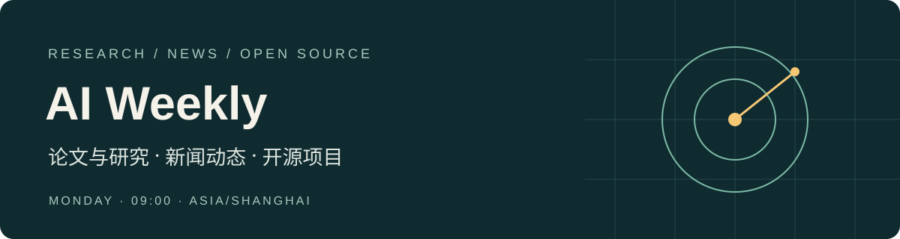

<p align="center"></p>

# AI 周刊

每周精选值得读、值得聊、值得试的 AI 进展。研究部分聚焦 LLM 与 Agent；新闻与开源项目覆盖整个人工智能领域，也关注产业、社会和公开人物动态。

[最新一期](#最新一期) · [往期归档](ARCHIVE.md) · [开源项目索引](PROJECTS.md) · [信息源](SOURCES.md) · [编辑准则](docs/EDITORIAL.md) · [RSS](https://raw.githubusercontent.com/735034777/agent-llm-weekly/main/feed.xml)

## 最新一期

<!-- LATEST:START -->
### [第 001 期｜记忆需要整理，AI 走进现实](content/001.md)

新闻周 2026-11-02 — 2026-11-08 · 发布 2026-11-12

研究 3 篇 · 新闻 5 条 · 项目 5 个

这一期从 Agent 怎样整理记忆谈起，再看模型发布、国家投入、用电与社区争议。开源部分挑了五个用途不同的项目，覆盖图表 Skill、语音、手机自动化、3D 动画和 Agent 工具。共 13 条精选，约 10—15 分钟；新闻回顾 11 月 2—8 日，研究采用近期正式发表或发布的材料，项目按 11 月 12 日的资料快照介绍。

<!-- LATEST:END -->

## 每期读什么

| 栏目 | 选题范围 | 通常篇数 |
| --- | --- | --- |
| 论文与研究 | 近期相关顶刊、顶会，以及大厂研究博客和技术报告；一篇稍深入，其余短介绍 | 3—4 |
| 新闻动态 | 模型与产品、价格与额度、芯片与机器人、产业与政策、社会事件、公开人物动态与趣事 | 5—7 |
| 开源项目 | 实用、有趣或有特色的全 AI 项目与 Skills，介绍用途、上手入口和必要条件 | 4—5 |

每期约 12—16 条，预计阅读 10—15 分钟；证据不足可以少发。项目参考 HelloGitHub 的选取方式，综合用途、特色、文档、可用性和维护情况。star 记录查询日期，作为关注度参考，不设最低值或入选比例。

研究通常回看最近 30 天，会议集中发表时可延长到 60 天。新闻严格对应上一完整自然周；开源项目可以是本期发现的已有作品，明确标注资料快照，避免把发现日期写成发布日期。三类内容各用合适的介绍方式，不强行套同一模板。

## 更新与订阅

- 每周一 **09:00（Asia/Shanghai）** 更新，新闻覆盖上一周一至周日。
- 第一期于 2026-11-12 发布，新闻周为 11-02—11-08；下一期新闻周为 11-09—11-15。
- 在 GitHub **Watch → Custom → Releases** 订阅发布，或使用上方 RSS。
- 联网研究、编辑与发布由本机 Codex 定时任务执行；GitHub Actions 校验数据与生成结果。准时执行依赖本机 Codex、网络和 GitHub 授权可用，尚未迁移到独立云端。延误时从最早缺失周补发。

## 来源与更正

优先引用论文、作者文章、官方发布与原始仓库；新闻也采用有署名的可靠媒体报道。区分正式发表、录用、预印本与研究博客，区分事实、作者主张和编辑判断。只有读到摘要时如实标注，没有实测就不写成亲测。

人物动态可以轻松，但涉及负面或私生活指控须有可靠公开依据，不传播匿名传言。固定关注 Tibo（[@thsottiaux](https://x.com/thsottiaux)）的 Codex 动态；额度消息核对原帖、时间及适用范围，社区归档不代表个人账户状态。

每期正文保留直接来源，详细核查范围与缺口放在 `evidence/NNN.md`。实质更正在当期留痕并同步 Release，Git 历史保留旧版本。推荐内容或纠错可提交 [Issue](https://github.com/735034777/agent-llm-weekly/issues/new/choose)。

## 维护

Python 3.11+，只用标准库。

```bash
python3 scripts/build.py --next-period
python3 scripts/build.py --write
python3 scripts/build.py --check
python3 -m unittest discover -s tests -v
```

输入为 `data/issues/NNN.json` 和 `data/sources.json`；构建器生成正文、核查记录、首页最新一期、归档、信息源目录、项目索引和 RSS。具体发布步骤见 [维护流程](docs/WORKFLOW.md)。结构校验不代替事实核查。

## 关于

形式与项目发现参考 [HelloGitHub 第 127 期](https://hellogithub.com/periodical/volume/127) 的 Skills、人工智能栏目及[公开审核标准](https://github.com/521xueweihan/HelloGitHub/issues/271)，独立撰写摘要，不复用其图片或标识。本项目与 HelloGitHub 无关联。

由 AI 辅助编写，维护者为 [735034777](https://github.com/735034777)。第三方论文、代码、模型和素材的权利及许可归原作者。项目沿用 `agent-llm-weekly` 仓库地址，展示名称为“AI 周刊”。
